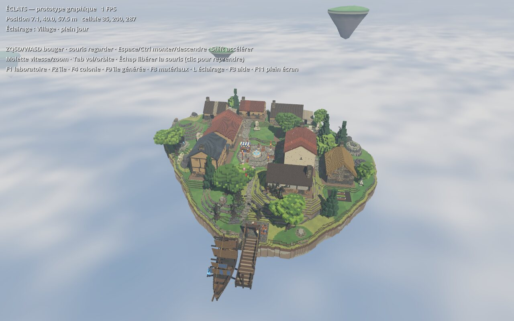
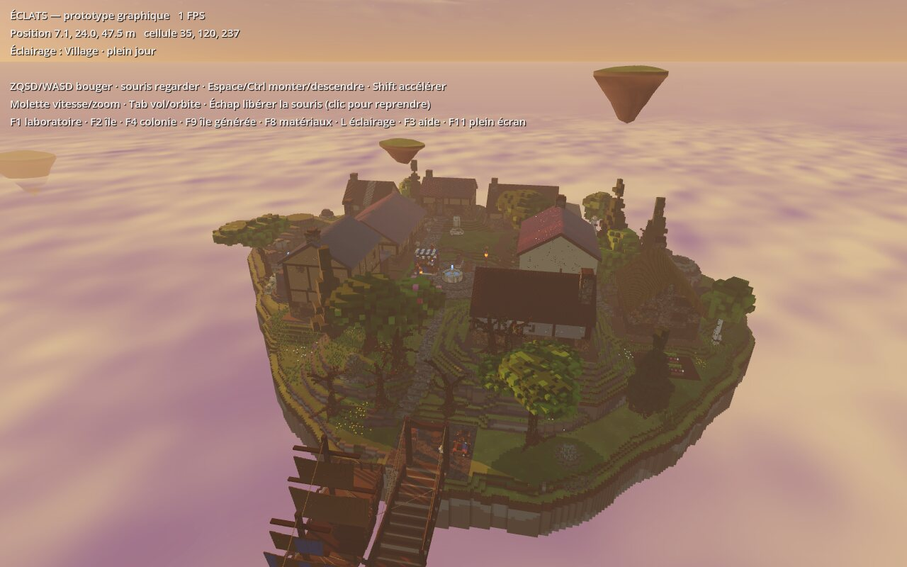
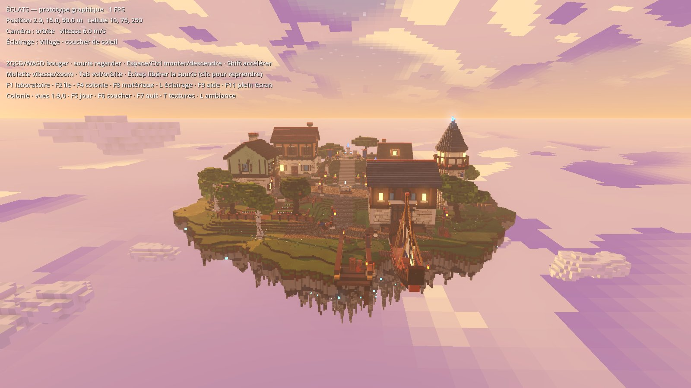
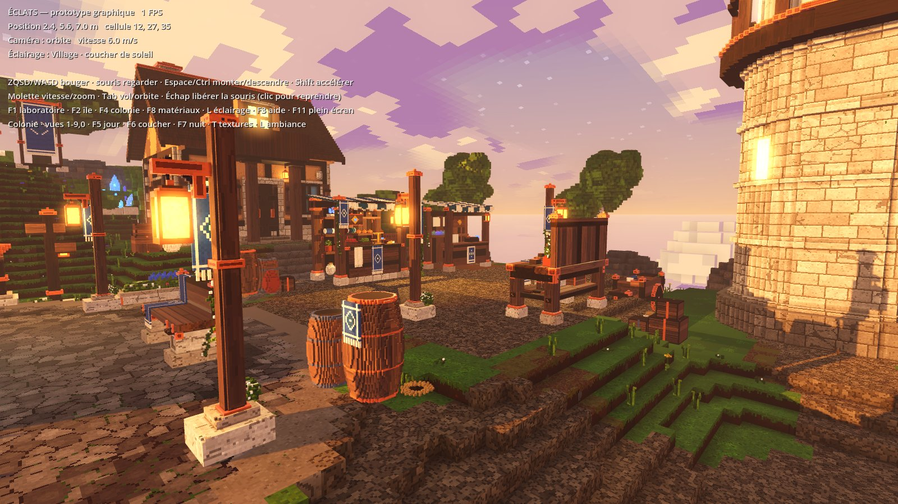
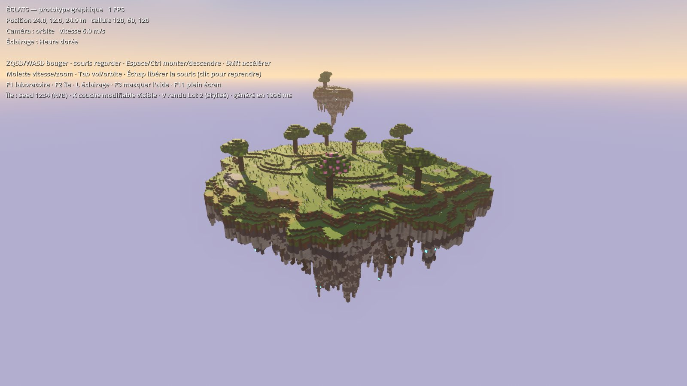
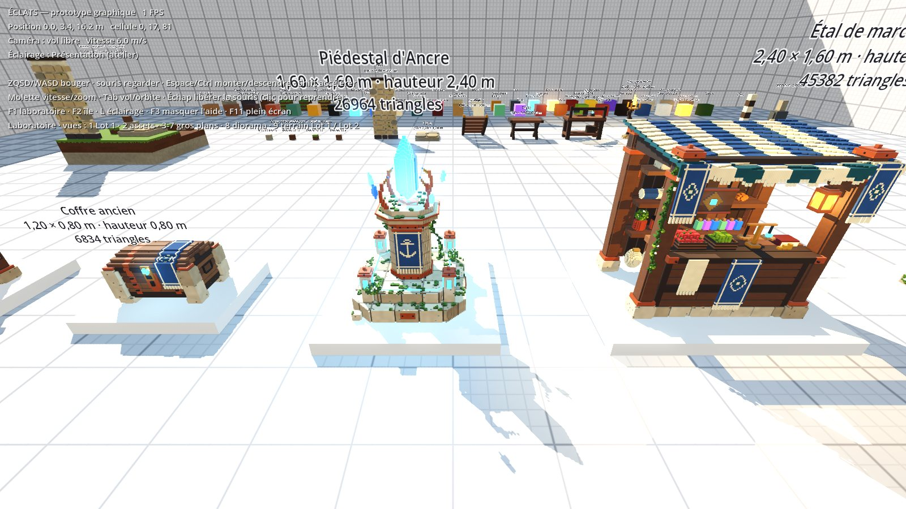

# ÉCLATS — fondations graphiques 3D (Lots 1 à 4)

RPG d'exploration et de construction sur des îles flottantes. Ce dépôt contient le
**premier prototype visuel** (Godot 4, GDScript, rendu Forward+) : un laboratoire
graphique, une première île voxel générée par seed, et une bibliothèque de 10 objets.
Pas de personnage, de quêtes, d'inventaire ni de combat dans ce lot.

**Lot 4** : **refonte structurelle de la génération** (touche **F9**) : terrain hiérarchique par profils, système de
placement universel (réservations, exceptions déclarées, refus explicites), colonie qui s'adapte au relief, bâtiments
de survivants **visitables** (intérieurs meublés), arbres / rochers / bateau paramétriques, ambiance centralisée
(anti-surexposition, nuages doux, îles lointaines) et **validation automatique** de chaque île générée.
Voir [docs/GENERATION_MONDE.md](docs/GENERATION_MONDE.md) et [docs/BILAN_LOT4.md](docs/BILAN_LOT4.md).




**Lot 3** : première **île habitée** (F4, scène de démarrage), shader de **pixels de 2 cm** sans aucune
image de texture, bibliothèque de 55 assets avec niveaux de détail, ambiances jour / coucher de soleil / nuit.




**Lot 2** : terrain stylisé sans mosaïque, microvoxels de 2 cm et 5 assets détaillés inspirés
des planches de concept (`docs/references/`).




## Ouvrir et tester sous Windows

1. Télécharger **Godot 4.3 (ou plus récent, 4.x) — version standard**, pas « .NET » :
   <https://godotengine.org/download/windows/> puis dézipper (aucune installation).
2. Récupérer le projet : bouton **Code → Download ZIP** sur GitHub (branche
   `claude/nifty-pascal-km2czc`), ou `git clone` puis `git checkout claude/nifty-pascal-km2czc`.
3. Lancer `Godot_v4.x-stable_win64.exe` → **Importer** → choisir le fichier `project.godot`
   du dossier → **Importer et éditer**. Le premier import prend quelques secondes.
4. Appuyer sur **F5** (ou le bouton ▶ en haut à droite) : le laboratoire s'ouvre.
   **F2** passe à l'île, **F1** revient au laboratoire.

Pour ouvrir une scène précise dans l'éditeur : `scenes/lab/graphics_lab.tscn` ou
`scenes/island/first_island.tscn`, puis **F6** (lancer la scène courante).

## Commandes

| Touche | Action |
|---|---|
| Z Q S D (AZERTY) / W A S D (QWERTY) | Se déplacer (touches physiques : les deux claviers marchent) |
| Souris | Regarder autour |
| Espace / Ctrl | Monter / descendre |
| Shift | Accélérer |
| Molette | Vitesse (vol) ou distance (orbite) |
| Tab | Basculer vol libre / orbite autour de l'île |
| Échap | Libérer la souris (clic gauche pour la reprendre) |
| F1 / F2 / F4 / F8 / **F9** | Laboratoire / Première île (Lot 2) / Île habitée (Lot 3) / Galerie de matériaux / **Île générée (Lot 4)** |
| L | Éclairage suivant (plein jour, heure dorée, neutre, crépuscule) |
| F3 | Masquer / afficher l'aide |
| F11 | Plein écran |
| 1 à 9, 0 (colonie) | Vues : village, bâtiments, marché, Ancre, port, textures du sol, détails (forge), façade, belvédère, bateau |
| F5 / F6 / F7 (colonie) | Ambiance : plein jour / coucher de soleil / nuit |
| T (colonie, galerie) | Nuances de pixels activées / désactivées (avant-après) |
| 1 à 6 (galerie) | Rangées de matériaux : bois, pierre, métaux, tissus et cristaux, terrain, toits |
| 1 (laboratoire) | Laboratoire : zone Lot 1 (objets de référence) |
| 2 | Laboratoire : vue globale des 5 assets |
| 3 à 7 | Laboratoire : gros plan sur chaque asset (établi, coffre, piédestal, étal, banc) |
| 8 / 9 | Laboratoire : diorama sur terrain voxel / comparaison terrain Lot 1 – Lot 2 |
| F9 : 1 à 9, 0 | Vues : vue d'ensemble, colonie, rue, sanctuaire, port, intérieur, bosquet, rochers, île lointaine, orbite |
| F9 : F5 / F6 / F7 | Ambiance : plein jour / coucher / nuit (fondu progressif) ; **Y** : cycle jour-nuit continu |
| F9 : N / B / G / R | Île suivante / précédente (graine) · profil suivant (habitée, verdoyante, rocheuse) · régénérer |
| F9 : V | Rapport de validation automatique (console) |
| N / B (île, Lot 2) | Seed suivante / précédente (régénère l'île) |
| V (île) | Basculer le rendu du terrain Lot 1 (ancien) / Lot 2 (stylisé) |
| K (île) | Masquer la couche modifiable → montre le cœur fixe |

## Vérification automatique

Sous Windows (PowerShell, depuis le dossier du projet) :

```powershell
.\tools\check.ps1 -Godot "C:\chemin\Godot_v4.3-stable_win64_console.exe"
```

Sous Linux / CI : `GODOT=/chemin/godot tools/check.sh`. La même vérification tourne
automatiquement sur GitHub à chaque push (`.github/workflows/godot-check.yml`).
Elle importe le projet en mode headless puis lance `tests/run_checks.gd` (180 contrôles, Lots 1 à 3) et
`tests/run_checks_lot4.gd` (120 contrôles rapides du Lot 4). `ECLATS_MONDE=1 tools/check.sh` (ou `check.ps1 -Monde`)
ajoute la validation d'îles complètes sur plusieurs graines et profils (+ 15 contrôles, ≈ 8 min sans GPU).

Diagnostic d'une génération (rapport lisible + JSON) :
`godot --headless -s tools/world_report.gd -- settled 1,2,3 rapport.json --determinisme`.

## Réglages lisibles

- `config/palette.json` : toutes les matières (couleur, variation, rugosité, émission).
- `config/lighting.json` : les préréglages d'éclairage (soleil, ciel, brouillard, lueur).
- `config/environment.json` : plafonds d'exposition, brume, nuages, îles lointaines, cycle jour/nuit (Lot 4).
- `config/profiles/*.json` : profils d'île (relief, falaises, climat, programme de colonie, végétation, rochers).
- `materials/voxel.gdshader` : rendu commun des voxels (liseré des arêtes, émission).
- Île : sélectionner le nœud `Island` dans `first_island.tscn` → seed, rayon, profondeur, collines.

## Documentation

- [docs/GENERATION_MONDE.md](docs/GENERATION_MONDE.md) — **règles et architecture de la génération** (Lot 4).
- [docs/BILAN_LOT4.md](docs/BILAN_LOT4.md) — bilan du Lot 4 (audit, refonte, mesures, contrôles auto vs validations GPU).
- [docs/DIRECTION_ARTISTIQUE.md](docs/DIRECTION_ARTISTIQUE.md) — **référence artistique** (planches dans `docs/references/`).
- [docs/ASSETS.md](docs/ASSETS.md) — les 5 assets, leur utilisation et leur génération.
- [docs/BILAN_LOT3.md](docs/BILAN_LOT3.md) — bilan du Lot 3 (mesures, tests, ce qui reste à valider sur GPU Windows).
- [docs/OPTIMISATION.md](docs/OPTIMISATION.md) — LOD, instanciation, collisions, lumières.
- [docs/BILAN_LOT2.md](docs/BILAN_LOT2.md) — vérifications, mesures, limites du Lot 2.
- [docs/ARCHITECTURE.md](docs/ARCHITECTURE.md) — organisation du code et choix techniques.
- [docs/BILAN_LOT1.md](docs/BILAN_LOT1.md) — vérifications réalisées, limites, prochaines étapes.
