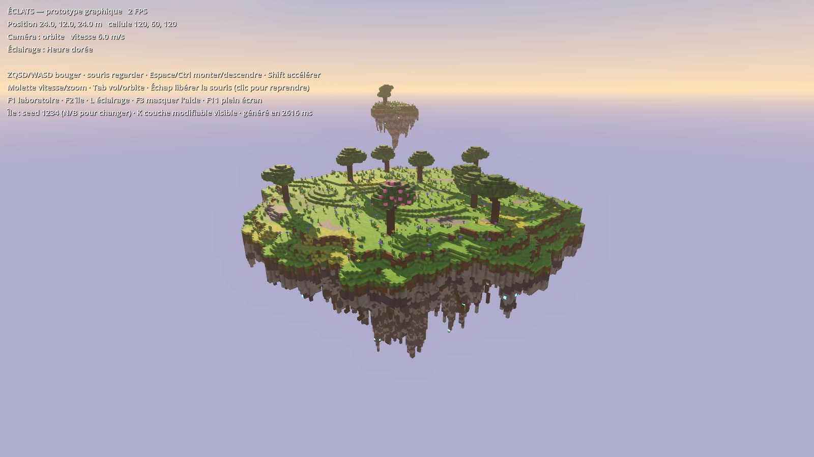

# ÉCLATS — Lot 1 : fondations graphiques 3D

RPG d'exploration et de construction sur des îles flottantes. Ce dépôt contient le
**premier prototype visuel** (Godot 4, GDScript, rendu Forward+) : un laboratoire
graphique, une première île voxel générée par seed, et une bibliothèque de 10 objets.
Pas de personnage, de quêtes, d'inventaire ni de combat dans ce lot.



## Ouvrir et tester sous Windows

1. Télécharger **Godot 4.3 (ou plus récent, 4.x) — version standard**, pas « .NET » :
   <https://godotengine.org/download/windows/> puis dézipper (aucune installation).
2. Récupérer le projet : bouton **Code → Download ZIP** sur GitHub (branche
   `claude/nifty-pascal-km2czc`), ou `git clone` puis `git checkout claude/nifty-pascal-km2czc`.
3. Lancer `Godot_v4.x-stable_win64.exe` → **Importer** → choisir le fichier `project.godot`
   du dossier → **Importer et éditer**. Le premier import prend quelques secondes.
4. Appuyer sur **F5** (ou le bouton ▶ en haut à droite) : le laboratoire s'ouvre.
   **F2** passe à l'île, **F1** revient au laboratoire.

Pour ouvrir une scène précise dans l'éditeur : `scenes/lab/graphics_lab.tscn` ou
`scenes/island/first_island.tscn`, puis **F6** (lancer la scène courante).

## Commandes

| Touche | Action |
|---|---|
| Z Q S D (AZERTY) / W A S D (QWERTY) | Se déplacer (touches physiques : les deux claviers marchent) |
| Souris | Regarder autour |
| Espace / Ctrl | Monter / descendre |
| Shift | Accélérer |
| Molette | Vitesse (vol) ou distance (orbite) |
| Tab | Basculer vol libre / orbite autour de l'île |
| Échap | Libérer la souris (clic gauche pour la reprendre) |
| F1 / F2 | Laboratoire / Première île |
| L | Éclairage suivant (plein jour, heure dorée, neutre, crépuscule) |
| F3 | Masquer / afficher l'aide |
| F11 | Plein écran |
| N / B (île) | Seed suivante / précédente (régénère l'île) |
| K (île) | Masquer la couche modifiable → montre le cœur fixe |

## Vérification automatique

Sous Windows (PowerShell, depuis le dossier du projet) :

```powershell
.\tools\check.ps1 -Godot "C:\chemin\Godot_v4.3-stable_win64_console.exe"
```

Sous Linux / CI : `GODOT=/chemin/godot tools/check.sh`. La même vérification tourne
automatiquement sur GitHub à chaque push (`.github/workflows/godot-check.yml`).
Elle importe le projet en mode headless puis lance `tests/run_checks.gd` (44 contrôles).

## Réglages lisibles

- `config/palette.json` : toutes les matières (couleur, variation, rugosité, émission).
- `config/lighting.json` : les préréglages d'éclairage (soleil, ciel, brouillard, lueur).
- `materials/voxel.gdshader` : rendu commun des voxels (liseré des arêtes, émission).
- Île : sélectionner le nœud `Island` dans `first_island.tscn` → seed, rayon, profondeur, collines.

## Documentation

- [docs/ARCHITECTURE.md](docs/ARCHITECTURE.md) — organisation du code et choix techniques.
- [docs/BILAN_LOT1.md](docs/BILAN_LOT1.md) — vérifications réalisées, limites, prochaines étapes.
