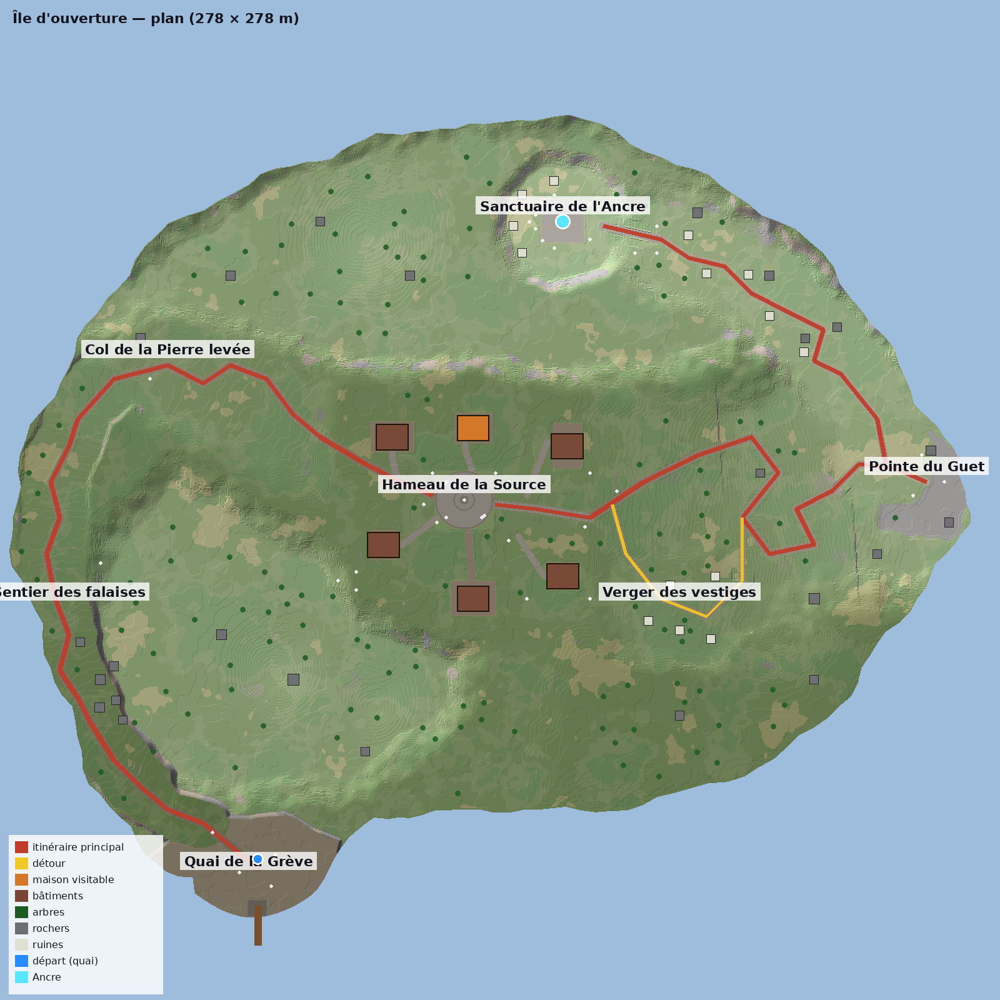

# Île d'ouverture (Lot 5)

Première île **jouable** d'ÉCLATS : une île **fixe**, dessinée à la main, beaucoup plus grande que l'île de test
du Lot 4 (≈ 41 500 m² de terre contre ≈ 2 100 m²), parcourue **en première personne** (Lot 6 ; **V** : vue à la troisième personne),
du quai jusqu'au sanctuaire de l'Ancre.

## Accès

- **Lancer le projet** (F5 dans l'éditeur, ou l'exécutable) : le **menu principal** s'ouvre (Lot 6) → *Jouer l'île d'ouverture*.
- **F10** depuis n'importe quelle scène ; **F9** reste l'accès au prototype précédent (île générée du Lot 4, aussi dans *Outils développeur*).
- **Échap** : pause (*Reprendre* / *Retour au menu principal*). **F3** : informations techniques à la demande.
- Scène : `scenes/game/opening_island.tscn`.
- Première ouverture : l'île est **construite** (≈ 1 à 2 min selon la machine) puis mise en cache
  (`user://cache/`, ≈ 70 Mo) ; les ouvertures suivantes la rechargent en quelques secondes.

## Commandes

| Touche | Action |
|---|---|
| Z Q S D (AZERTY) / W A S D (QWERTY), ou flèches | Se déplacer (touches **physiques** : les deux claviers marchent, l'aide affiche les lettres du clavier réel) |
| Souris | Regarder (clic gauche : recapturer la souris après une pause) |
| V | Changer de vue : première personne (défaut) / troisième personne |
| Molette | Distance de la caméra (troisième personne) |
| Maj | Courir |
| Espace | Sauter |
| **E** | Activer l'Ancre (à portée du cristal ; l'invite affiche la touche réellement assignée) |
| F5 / F6 / F7 | Plein jour / coucher / nuit |
| Ctrl + Suppr | Oublier la sauvegarde de l'île (pour rejouer l'activation) |
| F3 / F11 | Aide / plein écran |

À la troisième personne, la caméra se rapproche automatiquement dans les maisons. Une chute dans le vide ramène au quai.

## Parcours

| Zone | Silhouette | Repère |
|---|---|---|
| Quai de la Grève (départ) | grève basse au pied d'une falaise de 15 m | appontement à portiques, navire amarré, fanal |
| Sentier des falaises | corniche entre la falaise et le vide | chaos de blocs (Huelgoat), tour de guet |
| Col de la Pierre levée | ensellement entre les landes et le mont | menhir penché ; le hameau se découvre en contrebas |
| Hameau de la Source | cuvette habitée, toits groupés | place pavée, fontaine, grand parasol, **maison visitable à étage** |
| Verger des vestiges (détour) | terrasse plantée d'arbres fruitiers | arche et pans de murs en ruine ; rejoint les lacets |
| Pointe du Guet (point de vue) | éperon rocheux au-dessus du vide, à l'est | arche ouverte sur le vide, tor rocheux (Haytor), banc |
| Sanctuaire de l'Ancre | sommet rond au nord, falaises | cercle de colonnes, arche, braseros, cristal de l'Ancre |

Itinéraire principal ≈ 570 m, **≈ 4 min de marche** (2,2 m/s ; 4,1 min mesurées par la recette jouée, qui marche en ligne droite entre les repères) du quai au cristal, hors visite ;
détour du verger ≈ 95 m (≈ 30 s).

## Objectif et Ancre

- HUD : « ◆ Rejoindre le sanctuaire » en haut à droite (l'aide et les mesures du HUD validé restent en haut à gauche).
- À portée du cristal (3 m) : « **E · Activer l'Ancre** » (lettre lue sur la disposition du clavier).
- Activation : pulsation cyan (sphère qui s'étend, éclat de lumière), anneau discret au sol, bandeau
  « **Île découverte** », l'objectif disparaît.
- Sauvegarde : `user://eclats_sauvegarde.json`, sous l'identifiant **fixe** de l'île (`ile-ouverture-01`) ; à la
  relance l'Ancre est active (anneau et lueur) et l'objectif n'est plus affiché.

## Lot 10 : île remodelée

La carte a été retouchée à la main (départ sur le ponton, chaussée dallée, butte de révélation du hameau, avenue vers la fontaine, belvédère du Guet, arche du sanctuaire) :
voir [REMODELAGE_LOT10.md](REMODELAGE_LOT10.md). La carte du Lot 5 est conservée dans `config/islands/archive/`. Nouveautés de format : `spawn.pier_m` (départ sur le tablier) et `skirt` par chemin (largeur de l'épaule de raccord).

## Modifier l'île

Tout est dans **`config/islands/ile_ouverture.json`** (mètres ; x vers l'est, z vers le sud) :

- `terrain.outline` : contour de l'île ; `terrain.shapes` : formes de relief appliquées dans l'ordre
  (`poly`, `disc`, `line` à hauteur variable, `bump`) avec fondu `blend` (0 = falaise nette) et bords irréguliers `rough` ;
  `mat` impose une matière (gravier de la grève, roche de la pointe).
- `paths` : polylignes taillées dans le relief (largeur, matière ; `regular` = marches régulières ; `kind` main / detour).
- `plaza`, `buildings` (type, graine, position, orientation 0-3, `visitable`, allée de porte), `pier`, `anchor`, `spawn`.
- `trees`, `rocks` (famille, sous-type, variante, échelle), `props` (assets de la bibliothèque) : positions fixes.
- `zones` : noms et repères (plan, documentation).

Relancer : la carte a changé, le cache est invalidé, l'île est reconstruite. Les écarts éventuels (objet posé
malgré un refus du placement, arbre non posé) sont listés dans la console.

Plan annoté : `godot --headless -s tools/island_relief.gd -- res://config/islands/ile_ouverture.json relief.png --complet`
puis `python3 tools/plan_ile.py config/islands/ile_ouverture.json relief.png plan.png`.

## Construction (Lot 4 = bibliothèque)

`AuthoredTerrain` (relief dessiné → `TerrainField`) → `AuthoredIslandBuilder` : place (`TerrainEditor`), bâtiments
(`BuildingPlanner` / `BuildingBuilder`), quai et navire (`PortBuilder`, `ShipGenerator`), chemins (`PathNetwork`),
objets (`PlacementSystem`, assets cuits), rochers (`RockGenerator`), arbres (`TreeGenerator`), herbes
(`NatureGenerator`) → voxels par tuiles de 32 m (`TerrainVoxelizer`) + sous-face grossière (1 m) →
`AuthoredIslandView` (maillages, collisions : sol en carte de hauteurs, boîtes des bâtiments et meubles, rampe des
escaliers, troncs, rochers, objets, gradins de l'Ancre, tablier du quai).

## Recette

- `godot --headless -s tests/run_checks_lot5.gd` : contrôles rapides (carte, chemins, temps visé, détour, commandes, sauvegarde).
- `godot --headless --fixed-fps 60 -s tools/opening_recette.gd -- rapport.json` : **partie jouée** par un pilote
  automatique (mêmes collisions et vitesse que le joueur) : trajet complet chronométré, visite de la maison et de
  l'étage, détour, invite et activation de l'Ancre, sauvegarde, chute ; puis `-- rapport2.json --relance` dans un
  nouveau processus pour vérifier l'état retrouvé.
- `godot --rendering-driver opengl3 --fixed-fps 60 -s tools/opening_captures.gd -- rapport.json dossier` : captures
  aux positions de la partie jouée.
